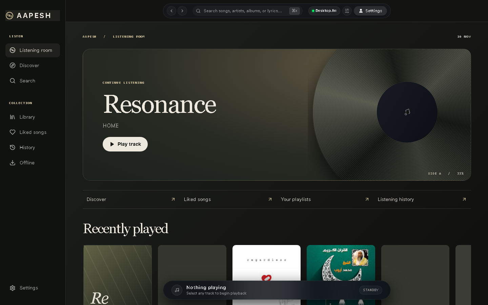
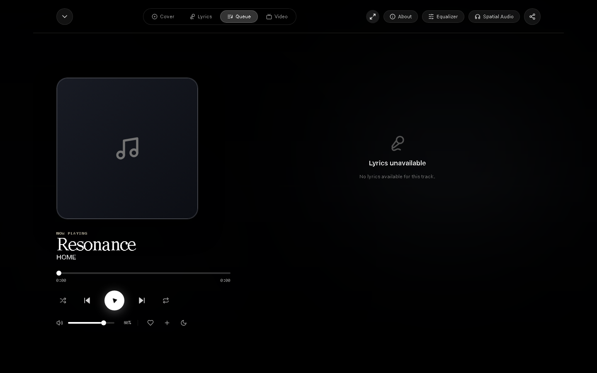
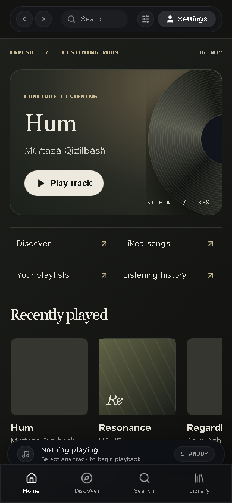
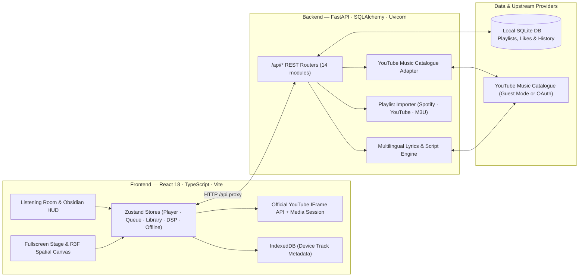

<div align="center">

<br />

# A A P E S H
### *Obsidian Listening Room & Spatial Music Workstation*

<p align="center">
  A desktop-first music player built around an atmospheric charcoal listening room, an artwork-led fullscreen stage, multilingual synced lyrics, and a local-first SQLite library — powered by the live YouTube Music catalogue.
</p>

<p align="center">
  
  
  
  
  
  
</p>

<p align="center">
  <a href="#showcase">Showcase</a> &nbsp;·&nbsp;
  <a href="#features">Features</a> &nbsp;·&nbsp;
  <a href="#architecture">Architecture</a> &nbsp;·&nbsp;
  <a href="#desktop-app">Desktop App</a> &nbsp;·&nbsp;
  <a href="#quick-start">Quick Start</a> &nbsp;·&nbsp;
  <a href="#api">API</a> &nbsp;·&nbsp;
  <a href="#boundaries">Boundaries</a> &nbsp;·&nbsp;
  <a href="#checks">Checks</a>
</p>

<br />



<sub><i>AAPESH Listening Room (1440×900) — Editorial serif typography, vinyl-sleeve hero (Side A / 33⅓), persistent glass transport dock, and live YouTube Music catalogue.</i></sub>

</div>

<br />

> *"Charcoal glass, brushed-metal accents, and a vinyl sleeve waiting on Side A — built to feel less like a spreadsheet of streams and more like sitting down in a late-night listening room."*

---

<a id="showcase"></a>

## ✦ The Listening Room

AAPESH separates **listening** from **collecting**. Browse live global charts, moods, artists, and full albums without creating an account, keep your own playlists, likes, and playback history locally in SQLite, and expand the persistent dock into a distraction-free stage whenever a track deserves the whole screen.

<table>
  <tr>
    <td width="72%" align="center" valign="top">
      
      <br />
      <sub><b>Expanded Stage (1440×900)</b> — Switch seamlessly between <b>Cover</b>, <b>Lyrics</b>, <b>Queue</b>, and <b>Video</b>, inspect track context via <b>About</b>, open the Equalizer drawer, toggle the 3D Spatial stage, or enter native browser fullscreen.</sub>
    </td>
    <td width="28%" align="center" valign="top">
      
      <br />
      <sub><b>Mobile Shell (390×844)</b> — Adaptive bottom navigation paired with a floating transport dock that never obscures content.</sub>
    </td>
  </tr>
</table>

---

<a id="features"></a>

## ◈ Inside the Workstation

### 1. Obsidian Spatial Soundstage & Listening Room
- **Vinyl-Sleeve Hero** — Resumes cleanly from actual listening history or live catalogue recommendations, keeping empty, history, and discovery states strictly distinct.
- **Persistent Glass Transport Dock** — Survives every route transition (`Home`, `Discover`, `Search`, `Artist`, `Album`, `Playlist`, `Library`, `History`, `Settings`) with synchronized playback state across compact, expanded, and native fullscreen modes.
- **Standalone `Desktop.fm` Mode** — Navigate to `/desktop-fm` (or `/teaser`) for a monochrome, keynote-minimal 3D chrome-disc showcase documented in [DESIGN_SYSTEM.md](DESIGN_SYSTEM.md).

### 2. Artwork-Led Fullscreen Stage & 3D Spatial Canvas
- **Four Synchronized Stage Views** — `Cover`, `Lyrics`, `Queue`, and `Video` share one live playback state inside the expanded player.
- **Optional WebGL Spatial Environment** — Lazy-loaded React Three Fiber + Three.js + Rapier stage (`ArtworkCard3D`, `FluidColorField3D`, `AtmosphereDust`, `SpatialPhysicsDebris`) plus ambient canvas modes (`FerrofluidCore`, `CymaticsGrid`, `StarfieldDrift`, `StealthMode`).
- **Power & Motion Respect** — The spatial render loop halts automatically when the stage is closed or when `prefers-reduced-motion` is enabled.

### 3. Multilingual Synced Lyrics Engine
- **Provider-Aware Timing** — Follows real provider timestamps when available; plain lyrics remain cleanly readable at line level without inventing fake word-by-word timing.
- **Script & Direction Intelligence** — Automatically detects script families (`script_detector.py`) and adapts RTL/LTR text direction and typeface per line.
- **Interactive Calibration** — Includes an inline sync-offset calibration toolbar and diagnostics view for fine-tuning lyric drift.

### 4. Queue 2.0, Radio & Anti-Buffer Playback
- **Official YouTube IFrame Engine** — Streams audio through the official YouTube IFrame Player API with cached `postMessage` queries, redundant-reload guards, and smart prebuffering to prevent buffering loops.
- **Hardware Media Keys** — Integrated with the browser **Media Session API** for keyboard media keys, lock-screen metadata, and OS transport controls.
- **Tactile Queue Control** — Reorder upcoming tracks via drag-and-drop or move controls, enqueue tracks to play next, spin up endless song radio, and inspect rich track metadata via **About This Song**.

### 5. Local-First Library & Multi-Source Importer
- **SQLite Persistence** — Local playlists (create, rename, edit description, add/remove specific entries, reorder tracks), liked songs, playback history, search history, and user preferences live in your own SQLite database.
- **Multi-Platform Playlist Importer** — Import existing playlists from **Spotify**, **YouTube**, or local **M3U** files directly into your local library.
- **Guest Mode + Optional Account Sync** — Full public catalogue search, charts, moods, radio, and lyrics work out of the box with zero credentials; optional YouTube Music OAuth can be configured at any time.

---

<a id="architecture"></a>

## ⬡ Architecture



### Tech Stack

| Layer | Technologies |
| :--- | :--- |
| **Interface** | React 18.3, TypeScript 5.7, Vite 6, Tailwind CSS, Zustand, Framer Motion / Motion, GSAP, Lucide Icons |
| **3D & Visual Stage** | Three.js, React Three Fiber (`@react-three/fiber`), `@react-three/drei`, `@react-three/postprocessing`, `@react-three/rapier` |
| **Backend API** | FastAPI, Uvicorn, SQLAlchemy 2, Pydantic v2, `ytmusicapi`, HTTPX |
| **Persistence** | Local SQLite (`aurora_music.db` in dev / `%APPDATA%\AAPESH\aapesh.db` on Windows desktop) + Browser IndexedDB |
| **Desktop Packaging** | PyWebView (WebView2 native window) + PyInstaller (`desktop_launcher.py` & `build_desktop.py`) |
| **Testing** | Vitest, React Testing Library, jsdom (frontend) · Pytest, Pytest-Asyncio (backend) |

---

<a id="desktop-app"></a>

## ⌘ Windows Desktop App

AAPESH can run as a standalone Windows desktop workstation via **PyWebView (WebView2)** and **PyInstaller**, bundling both the compiled Vite interface and the FastAPI server into a single native window.

- **Launch a built executable:** Open `dist/AAPESH.exe` to start the desktop workstation.
- **How it runs:** Spins up the bundled FastAPI backend and static frontend on an automatic free `127.0.0.1` port inside a native `1400×900` window (`1024×768` minimum).
- **Persistent Desktop Library:** Your playlists, likes, and listening history are stored safely in Windows Roaming AppData:
  ```text
  %APPDATA%\AAPESH\aapesh.db
  ```
- **Build from source:**
  ```bash
  python build_desktop.py
  ```

---

<a id="quick-start"></a>

## ⚡ Run Locally

### Prerequisites
- **Python 3.10+**
- **Node.js 18+** & **npm**

### 1. Start the FastAPI Backend
Run from the **repository root** so FastAPI locates the local SQLite database cleanly:

```bash
python -m pip install -r backend/requirements.txt
python -m uvicorn backend.app.main:app --host 127.0.0.1 --port 8000
```

### 2. Start the Vite Frontend
In a second terminal:

```bash
cd frontend
npm ci --legacy-peer-deps
npm run dev -- --host 127.0.0.1 --port 5187
```

Open **[http://127.0.0.1:5187](http://127.0.0.1:5187)** in your browser. Vite automatically proxies all `/api` requests to `http://127.0.0.1:8000`.

> [!NOTE]
> The development server is designed for local use. You can browse the entire public catalogue — search, charts, moods, radio, and lyrics — immediately in **Public Guest Mode** without configuring any credentials.

<details>
<summary><b>Environment & Optional YouTube Music OAuth Configuration</b></summary>

<br />

Copy [`.env.example`](.env.example) to `.env` in the repository root if you want to customize ports, CORS origins, cache TTL, database path, or optional YouTube Music account sync:

```ini
APP_ENV=development
PORT=8000
HOST=0.0.0.0
CORS_ORIGINS=http://localhost:5173,http://localhost:3000,http://127.0.0.1:5173
DATABASE_URL=sqlite:///./aurora_music.db
CACHE_TTL_SECONDS=1800

# Optional — leave blank for unauthenticated Public Guest Mode
YTMUSIC_OAUTH_TOKEN_PATH=oauth.json
YTMUSIC_CLIENT_ID=
YTMUSIC_CLIENT_SECRET=
```

To enable personal account sync (ratings, subscriptions, and remote playlists), follow the in-app **Settings** setup wizard or run `python -m backend.auth.setup`.

</details>

---

<a id="api"></a>

## ⎆ API Surface

All backend routes are mounted under `/api` and documented interactively at `http://127.0.0.1:8000/docs` when running locally.

<details>
<summary><b>View all 15 FastAPI route modules</b></summary>

<br />

| Module | Base Path | Highlights |
| :--- | :--- | :--- |
| **Health** | `/api/health` | Service & SQLite connection health check |
| **Home** | `/api/home` | Live listening room shelves & recommendations |
| **Search** | `/api/search` | Unified search, live suggestions, and local search history CRUD |
| **Songs** | `/api/songs` | Track details, watch playlist, and rich `/context` ("About This Song") |
| **Albums** | `/api/albums` | Full album metadata & ordered tracklists |
| **Artists** | `/api/artists` | Artist profiles, top tracks, discography, and related artists |
| **Charts** | `/api/charts` | Global & regional song and artist charts |
| **Moods** | `/api/moods` | Mood & genre categories and curated mood playlists |
| **Lyrics** | `/api/lyrics` | Multi-provider timed & plain lyrics with script metadata |
| **Recommendations** | `/api/recommendations` | Contextual recommendations and track-seeded `/radio/{video_id}` |
| **Playlists** | `/api/playlists` | Local SQLite playlist CRUD, track add/remove, and drag-order persistence |
| **Library** | `/api/library` | Aggregated library overview and liked-track toggles |
| **History** | `/api/history` | Local playback history logging, listing, and selective/full clearing |
| **Importer** | `/api/importer` | Import playlists from `/spotify`, `/youtube`, or `/m3u` |
| **Auth** | `/api/auth` | Guest/OAuth status inspection, setup instructions, and credential reload |

</details>

---

## 🗂 Repository Map

```text
aapesh/
├── backend/
│   ├── app/
│   │   ├── api/routes/         # 14 FastAPI routers (catalogue, library, lyrics, importer, auth)
│   │   ├── core/               # Settings & runtime configuration
│   │   ├── db/                 # SQLAlchemy engine & SQLite session lifecycle
│   │   ├── models/             # Playlist, LikedTrack, History, SearchHistory, Preference models
│   │   ├── schemas/            # Pydantic request/response contracts
│   │   └── services/           # ytmusic_service, cache_service, recommendation_service, lyrics_engine/
│   ├── auth/                   # Optional YouTube Music OAuth setup helper
│   ├── tests/                  # Pytest suite (runs against isolated temporary SQLite DBs)
│   └── requirements.txt
├── frontend/
│   └── src/
│       ├── api/                # Typed REST client
│       ├── components/
│       │   ├── canvas/         # SoundstageCanvas, FerrofluidCore, CymaticsGrid, StarfieldDrift, StealthMode
│       │   ├── desktop-fm/     # Standalone Desktop.fm chrome-disc experience
│       │   ├── hud/            # BottomTransportDock, LeftDock, TopTelemetryBar, EqualizerDrawer, WaveformScrubber
│       │   ├── layout/         # AppLayout, Sidebar, TopBar
│       │   ├── player/         # FullScreenPlayer, FullScreenArtworkScene, QueuePanel, LyricsPanel, AboutThisSongModal
│       │   ├── spatial/        # R3F 3D ArtworkCard3D, FluidColorField3D, AtmosphereDust, lighting
│       │   └── ...             # music/, search/, common/, react-bits/
│       ├── hooks/              # useSyncedLyrics, useSongContext, useAudioReactive, useBeatReactiveVisuals
│       ├── pages/              # Home, Discover, Search, Album, Artist, Playlist, Library, History, Settings, DesktopFm
│       ├── services/           # YouTubeIframeProvider, AudioReactiveEngine, IndexedDBStorageService
│       ├── stores/             # Zustand state (player, library, theme, UI, equalizer, DSP, offline)
│       └── test/               # Vitest & React Testing Library specs
├── screenshots/                # Desktop (1440×900), Expanded Player, and Mobile (390×844) captures
├── DESIGN_SYSTEM.md            # Desktop.fm visual specification & token reference
├── REDESIGN.md                 # Repository audit, architectural notes & verification scope
└── .env.example                # Optional environment & OAuth configuration template
```

---

<a id="boundaries"></a>

## ◎ Truthful Engineering

AAPESH is deliberate about what an embedded YouTube player can and cannot do — and refuses to fake telemetry:

- **Audio Streaming Requires Internet** — Playback runs exclusively through the official YouTube IFrame Player API.
- **Offline Storage Is Metadata-Only** — Saving a track on the device caches rich track details in IndexedDB for quick recall; it does **not** rip or download YouTube audio streams.
- **No Fabricated Audio Measurements** — Because browser cross-origin isolation prevents reading PCM samples from the YouTube iframe into a Web Audio `AnalyserNode`, the reactive audio engine truthfully reports zero frequency/beat energy when a live analyser is unavailable. Spatial visuals respond to artwork and playback state instead of inventing fake spectrum bars.
- **Honest Lyric Highlighting** — Tracks with real provider timestamps advance smoothly in sync; plain lyrics stay clean and readable without simulated karaoke timing.

---

<a id="checks"></a>

## ✓ Verification & Checks

Run the full backend and frontend verification suites:

```bash
# Backend API & catalogue contract tests (uses an isolated temporary SQLite DB)
python -m pytest backend/tests -q

# Frontend unit/component tests & production TypeScript/Vite build
cd frontend
npm test
npm run build
```

For the full repository audit, architectural decisions, and browser verification scope, read [REDESIGN.md](REDESIGN.md) and [DESIGN_SYSTEM.md](DESIGN_SYSTEM.md).
